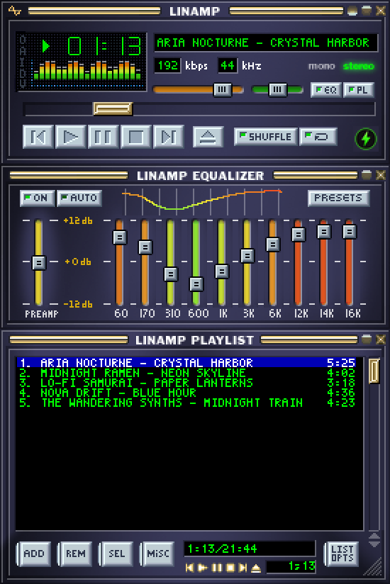

<div align="center">

<h1> &nbsp;LinAmp</h1>

A Winamp-inspired audio player for Linux and Windows, in Rust.

Pixel-perfect classic skin with `.wsz` skin support - 10-band EQ - live analyzer - playlist - audio conversion & CD ripping - full keyboard shortcut support



</div>

---

LinAmp recreates the classic Winamp feel, it loads real `.wsz` skins and
composites the main, equalizer and playlist windows at exact Winamp sprite
coordinates, on a modern cross-platform stack (`eframe`/`egui` UI,
`rodio`/`symphonia` audio, `lofty` tags).

## Features

- Classic skin UI, loads real Winamp `.wsz` skins; main + EQ + playlist as
  separate windows that dock and snap together, with window-shade mode.
- Plays MP3, MP1/MP2 (MPEG audio), FLAC, Ogg Vorbis, Opus, AAC/M4A, Monkey's Audio
  (APE), WavPack (WV), True Audio (TTA), Musepack (MPC), DSD (DSF/DFF), Speex (SPX), AC-3, WAV, AIFF and CAF, the audio track of
  MP4/M4V/3GP/MOV/MKV/WebM/OGV/TS/AVI/FLV/MPG/VOB
  video, MIDI (via a bundled SoundFont) and tracker modules (MOD/XM/S3M/IT), plus
  Windows Media Audio (WMA) in the optional FFmpeg build; seek,
  volume, stereo balance, repeat/shuffle, stop-after/stop-with-fade.
- Audio CD, play and rip (TOC and titles looked up online); rip or convert any
  track to MP3, Ogg Vorbis, Opus, FLAC, WAV or AIFF through a background queue.
- 10-band equalizer with presets, preamp and an auto-gain mode (live biquad DSP).
- Visualizer, live FFT spectrum analyzer and oscilloscope, skin-coloured.
- Playlist, add files/folders, drag-and-drop, reorder, sort, search, M3U/PLS.
- Tags & library, read/edit tags (ID3v1/ID3v2 for MP3, Vorbis for FLAC/Ogg/Opus,
  MP4 for M4A, APEv2), one file at a time or many at once with the mass editor;
  SQLite-backed media library.
- System integration, global media keys, a system-tray mode and "Open with" file
  associations (per-user, Windows and Linux).

Full feature list and roadmap: [FEATURES.md](FEATURES.md). The backlog lives in
[GitHub Issues](https://github.com/cjjulius/linamp/issues).

## Keyboard shortcuts

Matching classic Winamp. (Up/Down move the selection when the playlist window is
focused, otherwise they change the volume.) In the playlist, selection is
Winamp-style: click selects one row, Ctrl+click toggles a row, Shift+click
or Shift+Up/Down selects a range and Home/End jump to the first/last track.

| Keys | Action | | Keys | Action |
|------|--------|---|------|--------|
| `X` | Play | | `L` / `Shift+L` | Open file(s) / folder |
| `C` | Pause | | `J` / `Ctrl+J` | Jump to file / to time |
| `V` | Stop | | `Alt+G` / `Alt+E` | Toggle equalizer / playlist |
| `Shift+V` | Stop with fade-out | | `Ctrl+D` | Toggle double size |
| `Ctrl+V` | Stop after current (toggle) | | `Ctrl+P` | Preferences |
| `B` / `Z` | Next / previous track | | `Ctrl+T` | Time elapsed / remaining |
| `Space` | Play/pause toggle | | `Alt+3` | Edit file tags |
| `Left` / `Right` | Seek -5s / +5s | | `Enter` / `Delete` | Play / remove selected |
| `Up` / `Down` | Volume up / down | | `Ctrl+A` / `Insert` | Select all / add files |
| `R` / `S` | Repeat / shuffle | | | |

## Install

Grab the latest installer from the
[Releases page](https://github.com/cjjulius/linamp/releases/latest). Both are
per-user installs, no admin or `sudo` and keep your data on uninstall.

### Windows (10/11, 64-bit)

Download and run `LinAmp-<version>-Setup.exe`. It installs just for your user
(no UAC prompt) under `%LOCALAPPDATA%\Programs\LinAmp`, adds a Start-Menu and
optional desktop shortcut and can be removed from Settings, Apps, LinAmp.
Your library, config and session live in `%LOCALAPPDATA%\LinAmp` and are kept on
uninstall.

### Linux (per-user)

Extract the tarball (`linamp-<version>-linux-x86_64.tar.gz`) and run
`./install.sh`, no sudo. Launch LinAmp from your app menu or run
`~/.local/bin/linamp`. `./uninstall.sh` removes it. Files land in the standard
per-user locations:

| Path | What |
|------|------|
| `~/.local/bin/linamp` | launcher (symlink) |
| `~/.local/lib/linamp/` | the app, binary + bundled skins |
| `~/.local/share/LinAmp/` | your data, library, config, session |
| `~/.local/share/applications/linamp.desktop`, `…/icons/hicolor/*/apps/linamp.*` | menu entry + icon |

Uninstalling removes everything except `~/.local/share/LinAmp/`, your library
and settings are kept; delete that folder too for a full wipe. Target distros are
Ubuntu-based (Pop!_OS, Mint); audio goes to PipeWire via ALSA. See
[LINUX.md](LINUX.md) for details.

## Build from source

Install [Rust](https://rustup.rs) and [CMake](https://cmake.org/download/) (CMake
builds the bundled libopus for Opus decoding), then:

```bash
cargo build --release
./target/release/linamp            # or target\release\linamp.exe on Windows
```

Pass files or folders to open them: `linamp song.flac album/`.

- Windows needs CMake on PATH (for example `winget install Kitware.CMake`); no
  other setup.
- Linux needs CMake plus a few system libraries (ALSA, GTK, X11/Wayland), see
  [LINUX.md](LINUX.md). Audio targets PipeWire via ALSA.

### Optional WMA support (FFmpeg)

Windows Media Audio has no permissive pure-Rust decoder, so WMA playback is an
opt-in build that links the system FFmpeg libraries (LGPL). The default build is
pure Rust and omits WMA. To enable it, install the FFmpeg development libraries
(`libavcodec`, `libavformat`, `libavutil`, `libswresample`) and build with:

```bash
cargo build --release --features ffmpeg
```

On Debian/Ubuntu the libraries are `libavcodec-dev libavformat-dev libavutil-dev
libswresample-dev`. The resulting binary links those libraries at runtime, so a
machine running it needs the matching FFmpeg runtime libraries present.

Packaging the installers (Inno Setup / tarball) is documented in
[packaging/RELEASE.md](packaging/RELEASE.md).

## Skins

Several Winamp classic skins are bundled and show up in the skin picker. To use
any other classic `.wsz` skin, load it from the options menu (Load .wsz…); the
last skin you loaded is remembered across runs.

## Documentation

For how the pieces fit together, the module map, the multi-window model, the
fingerprint-cached render pipeline and the platform FFI boundary, see
[docs/ARCHITECTURE.md](docs/ARCHITECTURE.md). The keyboard and mouse shortcuts are
listed in [docs/SHORTCUTS.md](docs/SHORTCUTS.md), and the Winamp 2.666 parity
status is tracked in [docs/PARITY.md](docs/PARITY.md).

`cargo test` runs the suite (pure, cross-platform); CI builds and tests on Linux
and Windows for every push and PR.

## License

[Apache-2.0](LICENSE).
